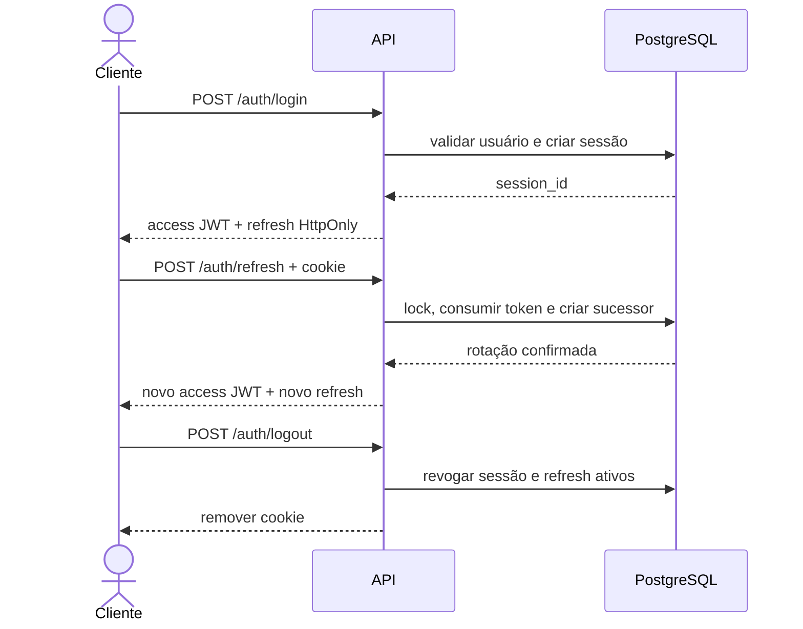

# Autenticação e sessões

Esta entrega implementa a sessão interna do SYNERGIA, access tokens JWT,
refresh tokens opacos de uso único, logout e revogação. A aplicação de RBAC e
escopo organizacional está descrita em [autorização](authorization.md).

## Fronteira de identidade

A identidade corporativa continua sendo o alvo de produção. Como o provedor
ainda não foi homologado, o adaptador local existe somente para desenvolvimento,
teste e homologação, fica desabilitado por padrão e nunca é ativado em
`production`. Recuperação e troca de senha local permanecem bloqueadas pelo
portão `ID-P04` da ADR.

O adaptador local requer simultaneamente:

```text
SYNERGIA_ENV=development|test|homologation
SYNERGIA_LOCAL_AUTH_ENABLED=true
```

Usuários precisam estar `active`, possuir e-mail ativo e um hash Argon2id já
provisionado. A API administrativa não recebe nem retorna senhas.

## Ciclo da sessão



O access token dura 15 minutos. O refresh possui janela ociosa de 8 horas e
limite absoluto de 24 horas. Cada autenticação cria uma sessão; o banco mantém
no máximo três sessões ativas por usuário e revoga a menos recente ao criar a
quarta.

## Contratos

| Método e rota | Credencial | Resultado |
| --- | --- | --- |
| `POST /auth/login` | e-mail e senha; adaptador local restrito | access token e refresh cookie |
| `POST /auth/refresh` | refresh cookie | rotação e novo par |
| `POST /auth/logout` | Bearer access token | revoga a sessão atual |
| `POST /auth/logout-all` | Bearer access token | revoga as sessões do próprio usuário |
| `GET /auth/sessions` | Bearer access token e `session.revoke.own` | sessões próprias ativas, sem credenciais |
| `DELETE /auth/sessions/{session_id}` | Bearer access token e `session.revoke.own` | revoga uma sessão própria |
| `POST /auth/sessions/revoke-others` | Bearer access token e `session.revoke.own` | revoga as demais sessões próprias |

A lista retorna UUID, indicação da sessão atual, navegador/sistema genéricos,
criação, último uso e expiração efetiva. O User-Agent bruto, IP, tokens e hashes
não são retornados nem persistidos como rótulo. Sessões expiradas, revogadas ou
de outro usuário não aparecem; revogação dessas sessões retorna o mesmo `404`.
Refresh e revogação travam a linha da sessão antes do token, evitando inversão
de locks. A matriz ainda não aprova leitura administrativa de sessões; portanto
nenhuma listagem ou interface de terceiros é exposta nesta entrega.

Login e refresh são as únicas operações públicas além das sondas `/health`,
`/health/live` e `/health/ready`; ambas validam sua própria credencial. A rota
`/metrics` usa credencial técnica separada. Logout exige um access token válido. Revogar
sessões de terceiros dependerá de `session.revoke.any` na camada de autorização.

O JWT exige `iss`, `aud`, `sub`, `sid`, `jti`, `iat`, `nbf`, `exp` e
`typ=access`. Emissor, audiência, chave e algoritmo vêm exclusivamente da
configuração do servidor. O algoritmo aceito neste incremento é `HS256`, sem
negociação pelo conteúdo do token.

O refresh nunca aparece no JSON. Ele usa cookie `HttpOnly`, `SameSite=Strict`,
`Path=/auth` e `Secure` obrigatório em produção. Requisições de navegador com
`Origin` fora de `AUTH_ALLOWED_ORIGINS` são recusadas.
Essa mesma lista configura o `CORSMiddleware`; preflight e validação da rota não
mantêm políticas independentes.

## Rotação, concorrência e replay

O hash SHA-256 do refresh é carregado com lock de linha. O token atual passa a
`used`, recebe `used_at` e aponta para o sucessor. Reutilizar um token usado
revoga a sessão e todos os tokens ainda ativos da família antes de retornar o
erro `refresh_token_reused`.

Duas rotações concorrentes são serializadas. Uma pode receber o sucessor, mas a
detecção de replay pela outra revoga a família inteira; nenhuma falha é exposta
como erro interno.

### Contrato do cliente web

O shell autenticado e o login público são estados mutuamente exclusivos. Ao
abrir `/login` com uma sessão válida, o cliente retorna para `/profile`. Ao
acessar uma rota protegida sem access token, tenta uma única renovação silenciosa:

- chamadas idempotentes concorrentes compartilham o mesmo refresh e só são
  repetidas uma vez depois da renovação;
- `POST`, `PUT`, `PATCH` e `DELETE` nunca são repetidos automaticamente; o
  refresh pode restaurar a sessão para a próxima ação, mas a operação original
  retorna o `401` para decisão explícita da tela;
- refresh expirado ou revogado limpa token, perfil, sessão e aparência antes de
  exibir somente o login público;
- o marcador não sensível em `sessionStorage` é apenas uma pista para distinguir
  uma sessão anterior: leitura, gravação ou remoção bloqueada pelo navegador não
  impede login, renovação ou limpeza do estado mantido em memória;
- credencial inválida (`401`), excesso de tentativas (`429`), indisponibilidade
  de rede/servidor (`0` ou `5xx`) e as demais recusas `4xx` recebem mensagens
  distintas;
- o retorno após novo login aceita apenas rotas internas conhecidas. URLs
  externas, relativas ao protocolo, codificadas para outro host ou apontando
  novamente para `/login` caem em `/profile`.

Esse fluxo evita replay de mutações, tempestade de refresh, navegação privada
residual e redirecionamento aberto.

O cookie de refresh é `HttpOnly`, portanto uma aba nova não consegue detectar
localmente se ele existe. Por decisão de produto, cada abertura de `/login` sem
access token faz uma única tentativa de refresh para impedir que uma sessão
válida exiba novamente o formulário. O limite padrão é de 30 tentativas por 60
segundos e contabiliza tanto a origem quanto, quando presente, a credencial do
cookie. Em redes corporativas com NAT, o limite por origem deve ser dimensionado
para a concorrência esperada e `RATE_LIMIT_TRUSTED_PROXY_CIDRS` deve listar
somente proxies efetivamente confiáveis. A configuração elevada usada pela
jornada Playwright é exclusiva do ambiente E2E e não altera o padrão de
produção.

O `returnUrl` preserva a query para restaurar filtros, abas e paginação da tela
operacional. Somente caminhos internos conhecidos são aceitos; credenciais,
segredos e dados pessoais não devem ser colocados em URLs. Identificadores
operacionais presentes na query podem aparecer no histórico do navegador e nos
logs de acesso, consequência aceita para manter o contexto de navegação.

Quando a renovação falha por indisponibilidade, o estado `unavailable` informa o
problema durante a execução atual e o marcador é removido junto com o restante
da sessão. Após recarregar, sem outra evidência de autenticação anterior, uma
rejeição posterior do refresh degrada para visita anônima, sem aviso incorreto
de expiração.

A regressão é coberta pelos testes de `session.service`, `auth.interceptor`,
guards e login. A jornada E2E cobre sessão revogada e acesso a `/login` com
sessão válida; concorrência single-flight, indisponibilidade e ausência de replay
de mutações ficam em testes unitários determinísticos, para evitar depender de
corridas e falhas artificiais no navegador.

## Limitação de tentativas

O padrão aceita cinco falhas em uma janela de 15 minutos e aplica bloqueio de
15 minutos. Os limites são configuráveis e calculados simultaneamente por
e-mail normalizado e por endereço IP, reduzindo ataques contra uma conta e
password spraying entre contas. Ambos são persistidos somente como
HMAC-SHA-256. Registros operacionais com mais de 48 horas são removidos durante
novas tentativas; os eventos de segurança append-only permanecem sem
credenciais ou tokens.

Usuário inexistente, senha incorreta e estado não ativo retornam o mesmo `401`
e executam uma verificação Argon2id de custo equivalente. Excesso retorna `429`
com `Retry-After`.

## Configuração criptográfica

`AUTH_JWT_SIGNING_KEY` deve vir de segredo externo e possuir pelo menos 32
bytes. Chaves reais não pertencem ao `.env.example`, Git, logs ou evidências.
Ausência de chave, issuer ou audience deixa a autenticação indisponível. Em
produção, `AUTH_REFRESH_COOKIE_SECURE=false` também falha de forma fechada.

O portão `ID-P05` continua exigindo definição corporativa de custódia e rotação
antes de implantação produtiva.

## Validação

```bash
cd backend
ruff check app tests ../scripts
pytest -q tests/test_auth.py
pytest -q -m integration tests/test_auth_persistence.py
```

Os testes usam somente identidades e segredos sintéticos sob `example.invalid`.
