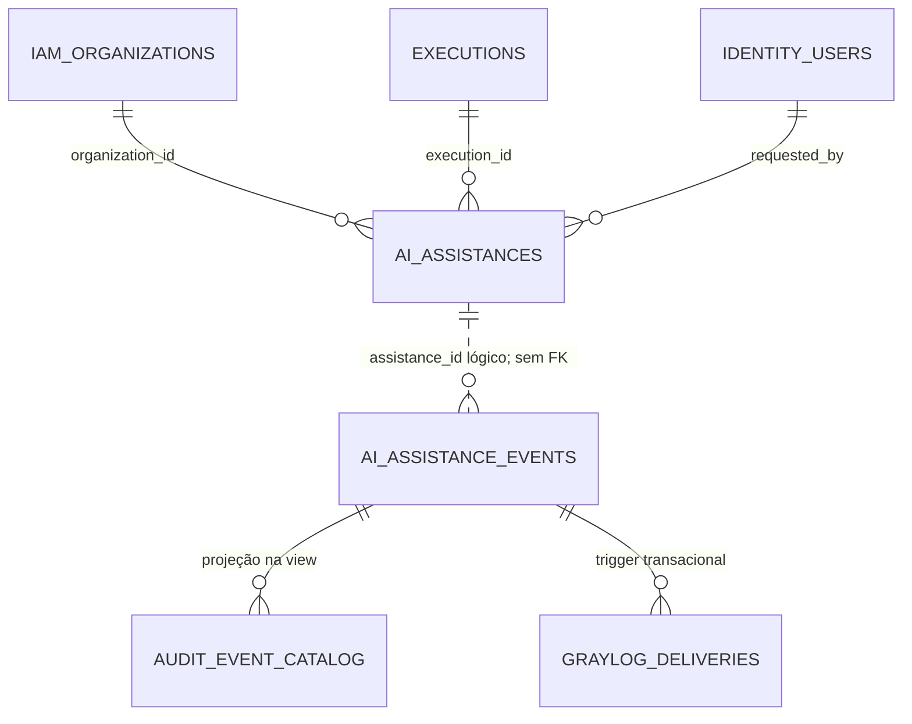

# Evidências técnicas — issue 188

## DDL e diagrama

O DDL integral executável e definitivo, com todos os campos, checks, índices,
função de validação, view e triggers, está em
[`0038_create_ai_assistance_persistence.sql`](../../database/migrations/0038_create_ai_assistance_persistence.sql);
a reversão está em [`0038_create_ai_assistance_persistence.down.sql`](../../database/rollbacks/0038_create_ai_assistance_persistence.down.sql).

| Objeto | Chaves, campos e restrições principais |
| --- | --- |
| `ai_assistances` | PK `id` UUID; FK `organization_id` para `iam_organizations`, `execution_id` para `executions` e `requested_by` para `identity_users`; estado, origem, modelo/digest, versão, três hashes, código de rejeição, `result` JSONB, duração e datas de reserva/conclusão/expiração. Checks impõem estados, formatos, coerência e estrutura restrita do resultado. |
| `ai_assistance_events` | PK `id` UUID; IDs de assistência, execução, organização, ator e correlação, ação, estado, origem, versão, modelo, hashes, código, duração e data. Trigger impede UPDATE/DELETE. Os IDs são preservados sem FK para a assistência, permitindo retenção independente após expiração. |
| Índices | `ai_assistance_idempotency` único com `NULLS NOT DISTINCT`; `ai_assistance_latest` por organização/execução/data; `ai_assistance_expiry` por expiração; `ai_assistance_reservations` parcial para reservas em processamento; índice de auditoria por organização/data. |
| Projeção | `audit_event_catalog` acrescenta eventos à view anterior; trigger `graylog_ai_assistance_insert` grava projeção sanitizada em `graylog_deliveries` na mesma transação. |



A auditoria específica usa `ai_assistance_events`, não grava cópias em
`audit_events`; os eventos aparecem no catálogo comum e na fila Graylog.

## EXPLAIN real — PostgreSQL 16

O teste `test_index_plans_with_representative_fixture` cria 3.000 registros
sintéticos com estados `processing`, `ready`, `insufficient_evidence` e `rejected`,
incluindo registros vencidos e vigentes, executa `ANALYZE` e imprime os planos das
consultas reais `latest`, `find`, `get`, `expire` e recuperação em `reserve`. A
consulta `reservation_monitor` é um diagnóstico operacional do índice parcial;
não é apresentada como consulta usada pelo repositório. UUIDs sintéticos foram
substituídos por `<uuid-sintetico>` abaixo; o restante é saída real do PostgreSQL.
`EXPLAIN` não executa os comandos `DELETE`.

```text
latest plan:
Limit  (cost=2.05..3.71 rows=1 width=1294)
  ->  Incremental Sort  (cost=2.05..1247.26 rows=750 width=1294)
        Sort Key: a.created_at DESC, a.id DESC
        Presorted Key: a.created_at
        ->  Nested Loop  (cost=0.43..1213.51 rows=750 width=1294)
              ->  Index Scan using ai_assistance_latest on ai_assistances a  (cost=0.28..1195.96 rows=750 width=1294)
                    Index Cond: ((organization_id = '<uuid-sintetico>'::uuid) AND (execution_id = '<uuid-sintetico>'::text))
                    Filter: ((state <> 'processing'::text) AND (context_sha256 = 'aaaaaaaaaaaaaaaaaaaaaaaaaaaaaaaaaaaaaaaaaaaaaaaaaaaaaaaaaaaaaaaa'::text) AND (expires_at > clock_timestamp()))
              ->  Materialize  (cost=0.14..8.17 rows=1 width=32)
                    ->  Index Only Scan using executions_id_organization_key on executions e  (cost=0.14..8.16 rows=1 width=32)
                          Index Cond: ((id = '<uuid-sintetico>'::text) AND (organization_id = '<uuid-sintetico>'::uuid))

find plan:
Nested Loop  (cost=0.55..16.62 rows=1 width=1294)
  ->  Index Scan using ai_assistance_idempotency on ai_assistances a  (cost=0.41..8.44 rows=1 width=1294)
        Index Cond: ((organization_id = '<uuid-sintetico>'::uuid) AND (execution_id = '<uuid-sintetico>'::text) AND (context_sha256 = 'aaaaaaaaaaaaaaaaaaaaaaaaaaaaaaaaaaaaaaaaaaaaaaaaaaaaaaaaaaaaaaaa'::text) AND (prompt_sha256 = '000000000000000000000000000000000000000000000000000000000000002a'::text) AND (contract_version = '1.0.0'::text))
        Filter: ((NOT (model_digest IS DISTINCT FROM NULL::text)) AND (state <> 'processing'::text) AND (expires_at > clock_timestamp()))
  ->  Index Only Scan using executions_id_organization_key on executions e  (cost=0.14..8.16 rows=1 width=32)
        Index Cond: ((id = '<uuid-sintetico>'::text) AND (organization_id = '<uuid-sintetico>'::uuid))

get plan:
Nested Loop  (cost=0.43..16.49 rows=1 width=1294)
  ->  Index Scan using ai_assistances_pkey on ai_assistances a  (cost=0.28..8.31 rows=1 width=1294)
        Index Cond: (id = '<uuid-sintetico>'::uuid)
        Filter: ((state <> 'processing'::text) AND (execution_id = '<uuid-sintetico>'::text) AND (organization_id = '<uuid-sintetico>'::uuid) AND (expires_at > clock_timestamp()))
  ->  Index Only Scan using executions_id_organization_key on executions e  (cost=0.14..8.16 rows=1 width=32)
        Index Cond: ((id = '<uuid-sintetico>'::text) AND (organization_id = '<uuid-sintetico>'::uuid))

expire plan:
Delete on ai_assistances  (cost=138.35..553.35 rows=100 width=46)
  ->  Hash Semi Join  (cost=138.35..553.35 rows=100 width=46)
        Hash Cond: (ai_assistances.id = "ANY_subquery".id)
        ->  Seq Scan on ai_assistances  (cost=0.00..406.01 rows=3001 width=22)
        ->  Hash  (cost=137.10..137.10 rows=100 width=56)
              ->  Subquery Scan on "ANY_subquery"  (cost=0.28..137.10 rows=100 width=56)
                    ->  Limit  (cost=0.28..136.10 rows=100 width=30)
                          ->  LockRows  (cost=0.28..1358.44 rows=1000 width=30)
                                ->  Index Scan using ai_assistance_expiry on ai_assistances ai_assistances_1  (cost=0.28..1348.44 rows=1000 width=30)
                                      Filter: (expires_at <= clock_timestamp())

reserve plan:
Delete on ai_assistances a  (cost=0.55..16.62 rows=1 width=12)
  ->  Nested Loop  (cost=0.55..16.62 rows=1 width=12)
        ->  Index Scan using ai_assistance_idempotency on ai_assistances a  (cost=0.41..8.45 rows=1 width=59)
              Index Cond: ((organization_id = '<uuid-sintetico>'::uuid) AND (execution_id = '<uuid-sintetico>'::text) AND (context_sha256 = 'aaaaaaaaaaaaaaaaaaaaaaaaaaaaaaaaaaaaaaaaaaaaaaaaaaaaaaaaaaaaaaaa'::text) AND (prompt_sha256 = '000000000000000000000000000000000000000000000000000000000000002a'::text) AND (contract_version = '1.0.0'::text))
              Filter: ((NOT (model_digest IS DISTINCT FROM NULL::text)) AND (((state = 'processing'::text) AND (reservation_until <= clock_timestamp())) OR (expires_at <= clock_timestamp())))
        ->  Index Scan using executions_id_organization_key on executions e  (cost=0.14..8.16 rows=1 width=54)
              Index Cond: ((id = '<uuid-sintetico>'::text) AND (organization_id = '<uuid-sintetico>'::uuid))

reservation_monitor plan:
Limit  (cost=0.28..12.38 rows=20 width=24)
  ->  Index Scan using ai_assistance_reservations on ai_assistances  (cost=0.28..151.64 rows=250 width=24)
        Filter: (reservation_until <= clock_timestamp())
```

O plano de expiração mostra uma varredura sequencial na etapa externa do DELETE e
uso do índice `ai_assistance_expiry` na seleção bloqueada e limitada. A escolha do
planejador pode variar com a distribuição e versão do PostgreSQL.

## Concorrência, limpeza e prova negativa

- `test_concurrent_reservations_have_single_winner`: 10 threads, uma reserva criada
  e nove conflitos controlados; não se afirma que as nove retornaram um resultado.
- `test_expire_multiple_batches_preserves_unexpired`: três vencidos e um vigente,
  lotes de dois com contagens 2, 1 e 0; o vigente permanece e há três eventos.
- `test_raw_content_rejected_by_application_and_database`: resumo com marcador
  sintético de segredo é recusado pelo repositório antes da escrita; tentativas SQL
  de incluir chave `prompt`, chave aninhada `raw_response` ou marcador de segredo
  no resumo sofrem `CheckViolation`; consulta posterior confirma ausência dos
  marcadores e das colunas de conteúdo bruto.
- A função SQL valida estrutura, tipos e vocabulário fechado do resultado; a
  validação da aplicação revalida contrato, texto permitido e referências. Os
  checks não devem ser entendidos como detector universal de todos os segredos
  imagináveis; a garantia depende também do contrato e do acesso restrito ao banco.

## Amostra real sanitizada

Eventos capturados do PostgreSQL descartável após reserva e conclusão determinística
com identificadores e hashes sintéticos. A fila recebeu duas entradas. Nenhum prompt,
contexto integral, texto de resultado ou resposta bruta integra esses eventos.

```json
{
  "events": [
    {
      "action": "requested",
      "state": "processing",
      "origin": null,
      "execution_id": "00000000-0000-4000-8000-000000000002",
      "organization_id": "00000000-0000-4000-8000-000000000001",
      "actor_user_id": "00000000-0000-4000-8000-000000000003",
      "correlation_id": "00000000-0000-4000-8000-000000000004",
      "context_sha256": "aaaaaaaaaaaaaaaaaaaaaaaaaaaaaaaaaaaaaaaaaaaaaaaaaaaaaaaaaaaaaaaa",
      "prompt_sha256": "bbbbbbbbbbbbbbbbbbbbbbbbbbbbbbbbbbbbbbbbbbbbbbbbbbbbbbbbbbbbbbbb",
      "response_sha256": null,
      "rejection_code": null,
      "elapsed_ms": null
    },
    {
      "action": "completed",
      "state": "insufficient_evidence",
      "origin": "deterministic",
      "execution_id": "00000000-0000-4000-8000-000000000002",
      "organization_id": "00000000-0000-4000-8000-000000000001",
      "actor_user_id": "00000000-0000-4000-8000-000000000003",
      "correlation_id": "00000000-0000-4000-8000-000000000004",
      "context_sha256": "aaaaaaaaaaaaaaaaaaaaaaaaaaaaaaaaaaaaaaaaaaaaaaaaaaaaaaaaaaaaaaaa",
      "prompt_sha256": "bbbbbbbbbbbbbbbbbbbbbbbbbbbbbbbbbbbbbbbbbbbbbbbbbbbbbbbbbbbbbbbb",
      "response_sha256": null,
      "rejection_code": null,
      "elapsed_ms": 1
    }
  ],
  "audit_projection": [
    {
      "action": "ai.assistance.requested",
      "resource_type": "ai_assistance",
      "outcome": "started",
      "metadata": {
        "state": "processing",
        "origin": null,
        "model_name": null,
        "duration_ms": null,
        "execution_id": "00000000-0000-4000-8000-000000000002",
        "model_digest": null,
        "prompt_sha256": "bbbbbbbbbbbbbbbbbbbbbbbbbbbbbbbbbbbbbbbbbbbbbbbbbbbbbbbbbbbbbbbb",
        "context_sha256": "aaaaaaaaaaaaaaaaaaaaaaaaaaaaaaaaaaaaaaaaaaaaaaaaaaaaaaaaaaaaaaaa",
        "rejection_code": null,
        "response_sha256": null,
        "contract_version": "1.0.0"
      }
    },
    {
      "action": "ai.assistance.completed",
      "resource_type": "ai_assistance",
      "outcome": "success",
      "metadata": {
        "state": "insufficient_evidence",
        "origin": "deterministic",
        "model_name": null,
        "duration_ms": 1,
        "execution_id": "00000000-0000-4000-8000-000000000002",
        "model_digest": null,
        "prompt_sha256": "bbbbbbbbbbbbbbbbbbbbbbbbbbbbbbbbbbbbbbbbbbbbbbbbbbbbbbbbbbbbbbbb",
        "context_sha256": "aaaaaaaaaaaaaaaaaaaaaaaaaaaaaaaaaaaaaaaaaaaaaaaaaaaaaaaaaaaaaaaa",
        "rejection_code": null,
        "response_sha256": null,
        "contract_version": "1.0.0"
      }
    }
  ],
  "queue": {
    "count": 2
  }
}
```

O teste `test_audit_projection_is_sanitized_and_exportable` compara metadados da
view com a projeção na fila e converte um evento para GELF. Isso comprova a
integração interna e a serialização; a entrega a um servidor Graylog externo não
foi exercitada.

## Resultado da regressão após a revisão

Com todas as migrations `0001`–`0038` aplicadas a um banco PostgreSQL 16
recém-criado, `pytest -q -m integration backend/tests` terminou com **857 testes
aprovados, 2146 desmarcados e 5 avisos de depreciação**, em 179,87 s. Os testes de
backup usaram `pg_dump` e `pg_restore` do mesmo container PostgreSQL 16, acessados
por invólucros locais para o banco descartável; nenhum banco existente foi usado.

As verificações adicionais de contrato, contexto, gerador, configuração, auditoria
e Graylog sem integração somaram **283 testes aprovados**. O caso dirigido de
persistência no estado final executou **23 testes**, incluindo revalidação do tipo
de referência. O teste dirigido de planos, concorrência, limpeza e conteúdo bruto
executou **5 testes**. O lint Ruff e `git diff --check` passaram.

A primeira tentativa da suíte integral após o ajuste inicial teve três falhas:
uma expectativa de inventário de tabelas, corrigida, e dois testes sem ferramentas
PostgreSQL nativas para a porta do banco descartável. Os dois passaram após usar as
ferramentas PostgreSQL 16; a execução integral citada acima passou depois de todas
as correções. Os avisos são de depreciação de Starlette, não falhas de teste.
