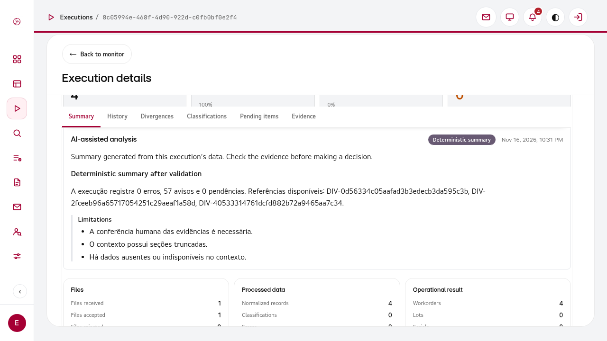
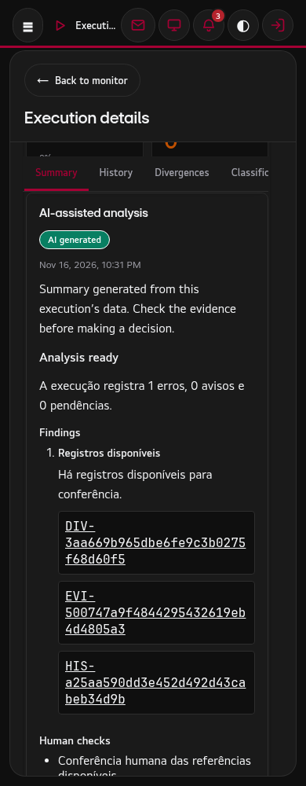

# Portões de Validação Integrada — Issue #192

## O que foi comprovado localmente no sandbox

| Portão / Verificação | Escopo comprovado no sandbox | Evidência / Denominador |
| --- | --- | --- |
| Separação experimental (código/rotas/OpenAPI) | `/ai/quality` ausente de `app.main`, router Angular, navegação e Dockerfiles; assets offline em `scripts/` | `test_ai_experimental_removal.py` (4/4), `test_web_journey_map.py`, `validate_web_journey_map.py`, `validate_access_matrix.py`, `validate_i18n.py` |
| Corpus congelado | 30 casos únicos em 5 categorias disjuntas, 2 orgs, múltiplas fontes, negações, instruções, controles, refs ausentes e alto volume; confinamento de paths e anti-adulteração | `data/synthetic/ai-assistance-v1/manifest.json`, `test_ai_assistance_corpus.py` (3/3) |
| Campanha controlada (`ci-fake`) | Validação por contrato/grounding real, preservação de rodadas e bytes brutos locais, falha não-zero quando runtime indisponível ou model/digest divergem | `test_ai_assistance_campaign.py` (4/4), `run_ai_assistance_campaign.py --mode ci-fake` (30/30) |
| Portões HTTP unitários (com overrides) | Transporte HTTP/pin, mismatch de digest, flags e rejeição de saídas inválidas | `test_ai_assistance_e2e_gates.py` (3/3) |
| Segurança do runner descartável e empacotador | Rejeição de URL/senha enganosa, recusa de banco não vazio, reconciliação exata de conjuntos e empacotamento zip confinado | `test_validate_issue_192_disposable.py` (3/3), `test_package_issue_192_evidence.py` (1/1) |
| Microbenchmark sem inferência | Apenas `SyntheticContextReader + prepare_prompt` (não inclui PostgreSQL/auth/persistência) | `run_ai_assistance_campaign.py --mode ci-fake` |

## Revisão independente no host — 16/11/2026 (America/Manaus)

| Verificação | Resultado observado | Limite da comprovação |
| --- | --- | --- |
| Regressões de documentação, campanha, empacotamento e runners | 52 testes aprovados no Python 3.12 | Subconjunto reproduzido pelo revisor; o executor registrou 96 testes direcionados |
| Integração PostgreSQL/API | Teste autocontido aprovado, autenticação real e duas organizações; hashes do conteúdo de negócio preservados | Inferência substituída somente por HTTP controlado |
| Leitura sem inferência | 5 aquecimentos e 30 amostras por operação; p95 detalhe = 86,97 ms e latest = 120,14 ms | Mede GETs reais; não comprova separadamente todas as etapas de geração |
| Instalação e rollback | 40 migrations aplicadas, rollbacks 0040–0037 exercitados em transação revertida, ledger mantido em 40 | Banco descartável novo; não executado no banco operacional |
| Frontend | 402 testes Angular aprovados; lint/build aprovados | Chromium headless e Node 22 |
| E2E | 8 testes aprovados em banco novo, incluindo importação XLSX real, reuso contado e recusa da organização B | Provider controlado; cenários visuais de indisponibilidade/flag ainda usam interceptação |
| Acessibilidade e layout | Axe sem violações nos estados exercitados, 390 px e zoom nativo de 250% | Escopo do card de assistência; não é auditoria de toda a aplicação |
| Artefatos de produção | Bundle real (53 arquivos), imagem backend e imagem web sem marcadores experimentais | Imagens exclusivas de revisão; aplicação existente não foi substituída |
| Auditoria | Exercício operacional existente executado novamente: 20 eventos reconciliados na pesquisa real do Graylog | Runtime HTTP sintético; não é correlação de cada caso da campanha Qwen |
| Observabilidade | promtool aprovou alertas de IA e regras de dashboard (42 regras) | Não substitui validação em infraestrutura corporativa |
| Campanha Qwen real | 30 casos: 16 ready, 8 rejected, 3 unavailable/timeouts, 3 insufficient_evidence; 27 chamadas | Portões `inference_completed` e `no_unavailable_on_sufficient` reprovados; não aprovar ativação |

Os três testes de reprodutibilidade XLSX que falharam na suíte ampla também
falham na `main`, inclusive com Python 3.12. A regressão nova de documentação
foi corrigida e os 42 testes documentais passaram. A causa das falhas de baseline
não foi atribuída a uma versão de Python sem comprovação.

As campanhas Qwen são preservadas por rodada, inclusive falhas. A tentativa
inicial encontrou `runtime_pin_mismatch` antes de inferir; ela não conta como
aprovação de modelo. O ensaio seguinte utiliza runtime isolado e manifesto
original com o digest congelado, sem alterar pesos, prompt ou critérios.

Resultado final: [relatório sanitizado por caso](issue-192-real-campaign.json).
As oito rejeições foram contidas: três `invalid_json`, quatro `invalid_schema` e
uma `ungrounded_summary`. Os três casos indisponíveis registraram
`runtime_timeout`. Os validadores de referência, grounding da **resposta entregue**
e limites passaram em 30/30; isso inclui os fallbacks, não significa 30 respostas
de modelo aceitas. Somente 16/27 tentativas aplicáveis produziram estado `ready`.
O freeze inicial/final permaneceu idêntico. Nenhum ajuste de prompt, schema,
pesos ou critério foi realizado durante a rodada.

Após encerrar a campanha, a CI identificou oito erros de formatação porque o
lint anterior foi chamado fora do diretório `backend`. A formatação mecânica
foi corrigida e `ruff check app tests ../scripts`, executado de `backend`, passou.
O manifesto foi regenerado por causa do hash textual do gerador; o relatório
real acima continua vinculado ao freeze/commit anterior. Não se apresenta esse
relatório como uma nova campanha do freeze pós-formatação.

O pacote local conserva as rodadas anteriores com falha de pin, a campanha final,
bytes sintéticos brutos, capturas/Axe, migrations, p95 e drill Graylog com hashes.
Traces de navegador com credenciais/tokens e arquivos privados do laboratório
foram excluídos; respostas brutas e o zip não são versionados.

## Portão de conclusão e pendências

**Integração ainda não declarada concluída.** A feature continua desligada por
padrão. Este registro não autoriza ativação produtiva nem encerramento da milestone.

- Resolver e revalidar os portões reprovados em nova rodada congelada; a presente
  campanha está encerrada e seus resultados não devem ser sobrescritos.
- Completar medição sem inferência das etapas de contexto e persistência de geração.
- Executar navegação integrada por cada tipo de referência disponível, não somente DIV.
- Comprovar no navegador flag e indisponibilidade reais no servidor, sem interceptação.
- Reconciliar a mesma jornada importação/assistência com Graylog; o exercício de
  20 recibos acima é complementar, não substituto dessa jornada.
- Validar implantação equivalente a homologação e obter resultados da CI do PR.

## Capturas da jornada sintética integrada

As capturas usam autenticação, importação e persistência reais com inferência
controlada. Não são evidências de conteúdo produzido pelo Qwen.

## Comandos de reprodução

1. **Campanha real com Qwen fixado:**
   `SYNERGIA_AI_ASSISTANCE_ENDPOINT=http://127.0.0.1:11434 backend/.venv/bin/python scripts/run_ai_assistance_campaign.py --mode real --output-dir .local-evidence/issue-192`
2. **Ensaio integrado real em PostgreSQL + p95 real de API/DB (sem overrides de auth/org/repo):**
   `DATABASE_URL="$SYNERGIA_192_DB_URL" backend/.venv/bin/pytest -q backend/tests/test_ai_assistance_integration_192.py`
3. **Migrations e rollback em banco descartável exclusivo da #192:**
   `SYNERGIA_ENV=test backend/.venv/bin/python scripts/validate_issue_192_disposable.py --database-url "$SYNERGIA_192_DB_URL" --output .local-evidence/issue-192/migrations-rollback.json`
4. **Suíte Angular (lint, unit, build), E2E Playwright + Axe e checagem de bundle/imagem:**
   - `cd web && npm run lint && npm test -- --watch=false --browsers=ChromeHeadless && npm run build`
   - `cd web && npx playwright test --config=playwright.assistance.config.ts`
   - `backend/.venv/bin/python scripts/check_experimental_absence_in_artifacts.py --web-dist web/dist/synergia-web/browser --backend-image  --web-image `
5. **Empacotamento único local de evidências:**
   `backend/.venv/bin/python scripts/package_issue_192_evidence.py --evidence-dir .local-evidence/issue-192`
