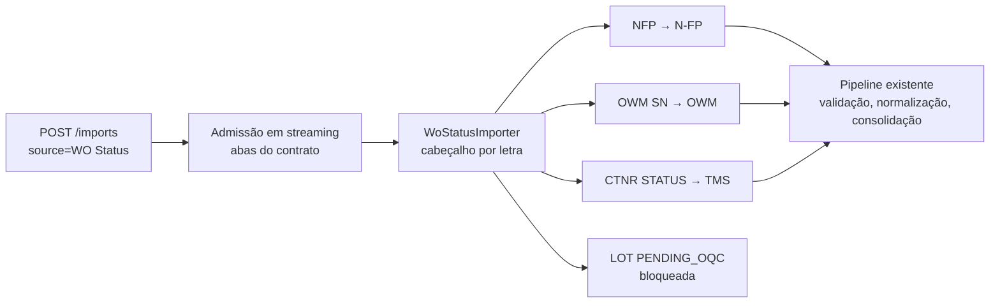

# Adapters da planilha WO Status

Os adapters implementam o contrato [real-workbook-contracts.md](real-workbook-contracts.md)
(`1.1.0-draft`) para as abas autorizadas da família `WO Status`. Eles não decidem
semântica de negócio: o que o cliente ainda não confirmou é preservado e marcado,
nunca inferido.

## Fluxo



Um upload de `WO Status` vira uma entrada de pipeline por aba autorizada. Cada aba
mantém o `source_file_id` do arquivo e a fonte lógica (N-FP, OWM, GMES/OQC ou TMS),
de modo que consolidação, regras, persistência e consultas não mudam. A fonte
composta só existe no arquivo, na inspeção e na execução (migration `0031`).

## Abas

| Aba | Fonte lógica | Cabeçalho / dados | Situação |
| --- | --- | --- | --- |
| `NFP` | N-FP | linha 3 / 4 | adapter ativo; identidade: `demand_id` ou `workorder_number` |
| `OWM SN` | OWM | linha 2 / 3 | adapter ativo; identidade: `serial_number` e `workorder_number` |
| `CTNR STATUS` | TMS | linha 1 / 2 | adapter ativo; identidade: `container_number` |
| `LOT PENDING_OQC` | GMES/OQC | linha 3 / 4 | adapter **bloqueado** pelo contrato |

As outras 13 abas do arquivo não são lidas nem ingeridas. Cada uma gera a
ocorrência `sheet_ignored` (aviso), para que o descarte seja auditável. Uma aba do
contrato não autorizada no ambiente gera `sheet_not_authorized`, e uma ausente gera
`sheet_missing`.

### `LOT PENDING_OQC` bloqueada

As linhas reais com `Status` têm `WO` e `Reason` calculados por fórmula, e o
contrato não aceita fórmula como chave. Enquanto o cliente não indicar uma fonte
literal, toda linha substantiva (com `Status` literal) é rejeitada com
`contract_blocked` e nenhum registro é produzido. As demais linhas pré-preenchidas
são contadas como ignoradas. Para liberar a aba, altere o contrato (nova versão) e
remova `blocked` da configuração.

## Seleção e leitura

- Cada coluna é identificada por **letra e cabeçalho esperado**. Se qualquer
  cabeçalho divergir, a aba inteira é descartada com `contract_drift` (erro
  estrutural, com a coluna e a linha do cabeçalho) e as outras abas seguem.
- Só as colunas mapeadas são lidas (`max_col`); colunas homônimas calculadas
  (`G`, `I`, `L` e `M` de `NFP`) e colunas calculadas (`Org` e `REASON` de
  `OWM SN`) nunca entram.
- Valores de colunas mapeadas que sejam fórmula são rejeitados por linha
  (`formula_not_allowed`), sem afetar as demais linhas.

### Conversões

| Tipo | Regra |
| --- | --- |
| identificador | texto preservado (zeros e caixa); número armazenado vira texto com aviso `identifier_stored_as_number`, pois zeros à esquerda não são recuperáveis |
| quantidade | decimal não negativo (inteiro em `qty_int`); inválida → `invalid_quantity` |
| data e data/hora | `datetime` do Excel preservado; número serial convertido; texto nos formatos `dd/mm/aaaa`, `aaaa-mm-dd` e variantes com hora; texto desconhecido é preservado com `unparsed_date`; sem fuso inventado |
| status e flags | valor preservado; o catálogo versionado de normalização marca o desconhecido (`unknown_state`, `unknown_oqc_flag`) mantendo o original |
| texto | `strip` |

### Janela de linhas

- `NFP` e `CTNR STATUS`: linhas sem nenhum valor mapeado são ignoradas
  (`ignored_blank`).
- `OWM SN`: o fim dos dados é a última linha com `Serial Number` literal. As
  linhas posteriores, preenchidas só por fórmulas nas colunas negadas, são
  ignoradas (`ignored_tail`); uma linha vazia **antes** disso é rejeitada
  (`gap_in_active_region`) e uma linha com valores e sem serial é rejeitada por
  identidade.
- `LOT PENDING_OQC`: só entra a linha com `Status` literal.

## Rejeições por linha

| Código | Severidade | Causa |
| --- | --- | --- |
| `formula_not_allowed` | erro | célula mapeada contém fórmula |
| `invalid_quantity` | erro | quantidade negativa, não numérica ou não inteira onde se exige inteiro |
| `invalid_date` | erro | serial de data fora do intervalo do Excel |
| `missing_identity` | erro | identificadores exigidos pelo contrato ausentes |
| `gap_in_active_region` | erro | linha vazia dentro da região ativa de `OWM SN` |
| `contract_blocked` | erro | aba bloqueada pelo contrato |
| `identifier_stored_as_number`, `unparsed_date` | aviso | valor preservado, mas fraco |

As regras genéricas continuam valendo: duplicidade de linha (`duplicate_row`,
aviso), de serial (`duplicate_serial`, erro) e identificadores inválidos. Uma linha
rejeitada não impede o processamento das independentes.

## Proveniência

Cada registro guarda a aba, a linha física, o `source_file_id` (e, portanto, o
arquivo e seu SHA-256) e, em cada transformação, a **coluna de origem**
(`"Y:Demand ID"`) e a **versão do adapter** (`wo_status@1.0.0`). O valor original
fica em `original_values`. Quantidades de contêiner de `TMS` usam nomes próprios
(`load_planned_quantity`, `load_quantity`, `load_remaining_quantity`) e `Plant` é
gravada como `plant`, sem efeito sobre o escopo organizacional.

## Validação sem persistência e reconciliação

```bash
python scripts/validate_wo_status.py arquivo.xlsx
DATABASE_URL=... python scripts/validate_wo_status.py arquivo.xlsx --execution-id <id> --strict
```

O modo executa os adapters e o pipeline sem gravar nada e imprime um relatório
somente com contagens, códigos e números de linha (nunca valores). Por aba:

| Campo | Significado |
| --- | --- |
| `read` | linhas percorridas a partir da primeira linha de dados |
| `ignored` / `ignored_total` | em branco, cauda e não substantivas |
| `entered_validation` | linhas emitidas mais placeholders de rejeição |
| `rejected` | linhas com algum erro, do adapter ou da validação |
| `duplicated` | linhas com `duplicate_row` ou `duplicate_serial` |
| `imported` / `normalized` | registros que serão persistidos |
| `balanced` | `read = ignored + entered_validation` e `entered_validation = normalized + rejected` |

Com `--execution-id`, o relatório compara `imported` e `normalized` por aba com
`imported_records` e `normalized_records` da execução (consulta somente leitura) e
lista as diferenças. `--strict` retorna código 1 se houver deriva de contrato,
desequilíbrio ou divergência.

## Idempotência

- O mesmo arquivo (SHA-256) enviado duas vezes é recusado com `duplicate_file`.
- O resultado dos adapters é determinístico: reprocessar o mesmo arquivo produz os
  mesmos registros, ocorrências e resumo (teste de regressão).
- Uma segunda confirmação do mesmo resultado é recusada sem duplicar registros.

## Limites da fonte

A fonte `WO Status` usa os orçamentos de [xlsx-ingestion-budget.md](xlsx-ingestion-budget.md)
contando apenas as colunas que o adapter mantém. As abas autorizadas são, por
padrão, as do contrato; `INGESTION_ALLOWED_SHEETS_WO_STATUS` pode restringi-las.

### Medição no workbook representativo

Arquivo de 41,5 MB com 17 abas e 471 MB descompactados, processado somente em
ambiente local autorizado (Ubuntu 24.04, Python 3.12, 7 GiB de RAM); nenhum valor é
registrado.

| Etapa | Resultado |
| --- | --- |
| admissão em streaming (`inspect_content`, limites da fonte) | 26 s, 46 MiB de RSS |
| adapters + pipeline sem persistência (`validate_wo_status.py`) | 3 min 10 s, 688 MiB de RSS no pico |

Por aba (relatório de reconciliação, todas equilibradas):

| Aba | Lidas | Ignoradas | Rejeitadas | Normalizadas | Ocorrências |
| --- | --- | --- | --- | --- | --- |
| `NFP` | 8.309 | 0 | 1 | 8.308 | 1 `invalid_quantity`; 3.788 `unknown_state` |
| `OWM SN` | 93.495 | 33.425 (cauda de fórmulas) | 0 | 60.070 | 5.849 `identifier_stored_as_number`; 60.070 `unknown_state` e `unknown_oqc_flag` |
| `LOT PENDING_OQC` | 130 | 112 | 18 (`contract_blocked`) | 0 | — |
| `CTNR STATUS` | 398 | 0 | 0 | 398 | — |

O resultado confirma as decisões do contrato: a cauda de `OWM SN` é exatamente a
diferença entre as linhas físicas e os seriais literais, e as 18 linhas
substantivas de `LOT PENDING_OQC` ficam bloqueadas. Os estados e flags aparecem
como desconhecidos porque o catálogo de normalização ainda não conhece os valores
do cliente (pergunta pendente do contrato); os valores originais ficam preservados.
As datas de `CTNR STATUS` chegam como texto `dd/Mon/aaaa [hh:mm:ss]` e são
convertidas sem fuso. Como o intervalo de datas é texto, uma data fora desse
formato é preservada com aviso.

### Limites padrão da fonte

Com base nessa medição, a fonte `WO Status` usa estes padrões (cada um pode ser
sobrescrito pelo sufixo `_WO_STATUS`):

| Limite | Padrão | Medido |
| --- | --- | --- |
| `UPLOAD_MAX_BYTES` | 64 MiB | 41,5 MB |
| `UPLOAD_MAX_ARCHIVE_UNCOMPRESSED_BYTES` | 640 MiB | 471 MB |
| `INGESTION_MAX_SECONDS` | 900 s | 190 s de adapters e pipeline (relógio por arquivo) |
| `INGESTION_MAX_CELLS` | 2.000.000 | ~1,1 milhão de células mapeadas |
| `INGESTION_MAX_MEMORY_BYTES` | 1 GiB | 68.776 registros normalizados, estimativa abaixo de 1 GiB |

Os limites globais de upload, pensados para arquivos genéricos, não se aplicam a
esta fonte.

## Limitações e pendências

- `LOT PENDING_OQC` depende de resposta do cliente (fonte literal da chave).
- Status, flags de OQC, fuso das datas, equivalência de `Plant` com a organização e
  a precedência entre `OWM SN`, `OWMS Hold` e `LOT PENDING_OQC` seguem como
  perguntas do contrato; o adapter preserva os valores e sinaliza o que não conhece.
- Identificadores gravados como número perdem zeros à esquerda na origem.
- A tela de importação ainda não lista a fonte `WO Status`; o envio é pela API.
- `Total Decision` é tratado em issue própria (#140).
